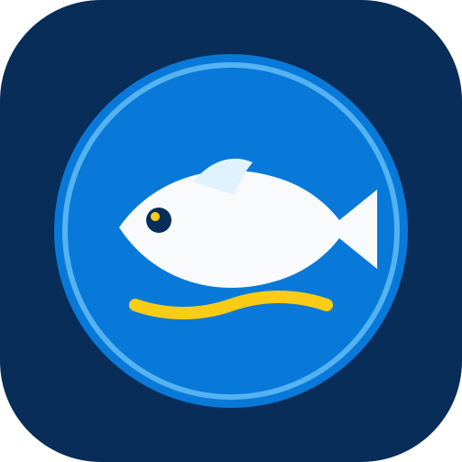
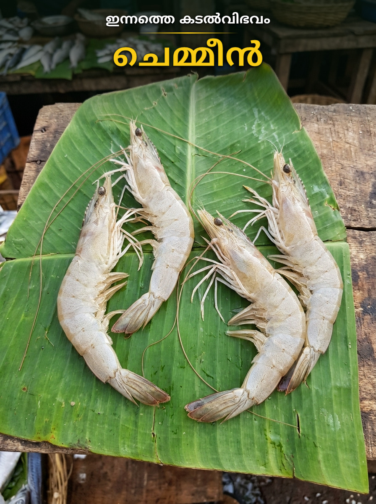
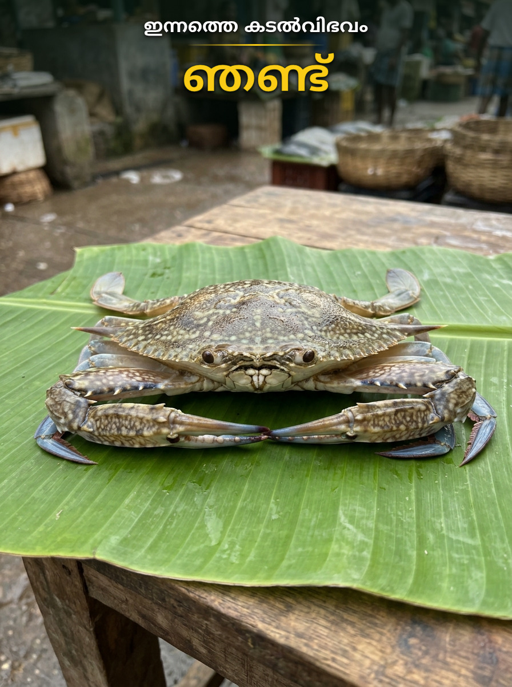
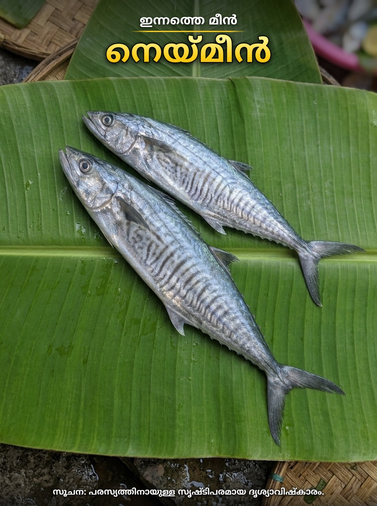

<!--
  Coastal Fish Availability — Project README
  This README intentionally contains no personal contact details or private owner information.
-->

<div align="center">

  

  <h1>🐟 Coastal Fish Availability</h1>

  <p><strong>A simple, offline-ready way to manage daily fish availability, create beautiful fish posters, and share updates with customers.</strong></p>

  <p>
    <a href="https://x7z9.github.io/biju-chettan-fresh-meen/"><strong>🌊 Open the App</strong></a>
    ·
    <a href="https://github.com/x7z9/biju-chettan-fresh-meen/issues">Report an Issue</a>
    ·
    <a href="#-getting-started">Get Started</a>
  </p>

  <p>
    
    
    
    
  </p>

  <p>
    
    
    
  </p>

</div>

<p align="center">
  
  
  
</p>

<p align="center"><em>A visual-first fish and seafood catalogue with reusable photos and daily sharing tools.</em></p>

---

## 🌅 About the Project

**Coastal Fish Availability** is a mobile-first Progressive Web App (PWA) designed to make everyday fish-selling updates easier to prepare and share.

Fish sellers can maintain a catalogue of fish and seafood, mark what is available today, attach real product photos, optionally add prices or notes, generate professional promotional posters, and share daily updates through WhatsApp or the device sharing menu.

The application is designed around practical coastal-market workflows: fast interactions, readable Malayalam, simple controls, offline-friendly operation, and reusable daily content.

> **Built for the rhythm of coastal markets:** update availability, prepare the visual, and share the day's catch.

## ✨ Highlights

<table>
  <tr>
    <td width="50%">
      <h3>🐠 Daily Availability</h3>
      Mark fish as available or unavailable, search the catalogue, filter the current list, and add optional prices or notes.
    </td>
    <td width="50%">
      <h3>📸 Fish Photo Catalogue</h3>
      Maintain reusable fish entries with Malayalam names, English names, pronunciations, reference artwork, and actual uploaded photos.
    </td>
  </tr>
  <tr>
    <td>
      <h3>🎨 Poster Studio</h3>
      Create portrait 3:4 promotional posters using uploaded fish photographs, selectable backgrounds, language options, and optional details.
    </td>
    <td>
      <h3>💬 WhatsApp Sharing</h3>
      Share daily text updates, a combined menu poster, or selected individual fish photos with generated captions.
    </td>
  </tr>
  <tr>
    <td>
      <h3>📚 Daily History</h3>
      Review previous availability records and revisit saved poster outputs.
    </td>
    <td>
      <h3>📦 Backup & Restore</h3>
      Export application data to a JSON backup and restore it later on a supported device or browser.
    </td>
  </tr>
  <tr>
    <td>
      <h3>📶 Offline-Friendly</h3>
      Use locally saved catalogue and daily records when connectivity is unavailable. Cached application resources support repeat visits.
    </td>
    <td>
      <h3>📱 Installable PWA</h3>
      Add the app to a compatible phone or desktop home screen for an app-like experience.
    </td>
  </tr>
</table>

## 🖼️ App Experience

The application is organised around four primary work areas:

| Area | What it does |
|---|---|
| **Today** | Manage current-day availability, pricing, notes, and sharing |
| **Fish** | Browse and maintain the reusable fish catalogue |
| **Add New** | Create or edit fish entries and upload photos |
| **More** | Configure language, business display settings, posters, history, backup, and restore |

The interface supports **Malayalam and English**, with a mobile-first layout and a bottom navigation bar on smaller screens.

## 🧭 How It Works

1. **Build the catalogue** — add fish and seafood names, pronunciations, reference details, and actual photos.
2. **Update today's stock** — open the Today screen and mark the items currently available.
3. **Add optional details** — enter prices, units, or short notes when needed.
4. **Create visuals** — generate a dedicated fish poster or a combined daily menu poster.
5. **Share the update** — use the native share sheet or WhatsApp helper to send text and photos.
6. **Keep a backup** — periodically export a JSON backup to protect locally stored information.

## 🎨 Poster Creation

The poster studio is designed for clear, image-led daily fish announcements.

- Portrait **3:4 aspect ratio** output.
- Two built-in background styles: **Blue Tray** and **Banana Leaf**.
- Malayalam, English, and bilingual poster modes.
- Use actual uploaded fish photographs as the primary visual.
- Adjust image framing, zoom, brightness, and contrast.
- Optionally include price, notes, and a configurable disclaimer.
- Preview, save, download, and share the generated poster.

The daily menu poster feature can combine the currently available fish into one shareable visual.

## 💬 Sharing & Customer Communication

The sharing workflow provides multiple ways to prepare a daily update:

- **Individual photos** — share selected fish photographs with a matching text caption.
- **Menu card** — create a combined availability poster.
- **Text only** — share a simple availability message.
- **Batch sharing** — split larger photo sets into smaller groups when device sharing limits require it.
- **WhatsApp fallback** — open WhatsApp with a prepared text message when direct file sharing is unavailable.

Sharing is user-initiated. The application does not silently post to WhatsApp groups or send messages to customers in the background.

## 🏗️ Technology Stack

| Layer | Technology |
|---|---|
| UI | React 19 |
| Language | TypeScript |
| Build tooling | Vite |
| Styling | Tailwind CSS |
| Icons | Lucide React |
| Local database | IndexedDB |
| Browser preferences | Local Storage |
| Poster rendering | HTML Canvas |
| PWA | vite-plugin-pwa / Workbox |
| Hosting | GitHub Pages |
| Deployment | GitHub Actions |

## 🗂️ Project Structure

```text
.
├── public/
│   ├── assets/
│   │   ├── aistudio/
│   │   └── catalog/
│   ├── icon.svg
│   └── ...
├── src/
│   ├── components/
│   │   ├── AddEditFishScreen.tsx
│   │   ├── FishCatalogueScreen.tsx
│   │   ├── MoreScreen.tsx
│   │   ├── PosterStudioModal.tsx
│   │   ├── ShareListModal.tsx
│   │   └── TodayScreen.tsx
│   ├── data/
│   │   ├── seedCatalog.ts
│   │   └── translations.ts
│   ├── db/
│   │   └── indexedDb.ts
│   ├── hooks/
│   │   ├── useOnlineStatus.ts
│   │   └── usePWAInstall.ts
│   ├── utils/
│   │   ├── offlineSearch.ts
│   │   ├── posterRenderer.ts
│   │   ├── speechAndDate.ts
│   │   └── whatsappHelper.ts
│   ├── App.tsx
│   ├── index.css
│   ├── main.tsx
│   └── types.ts
├── .github/
│   └── workflows/
│       └── deploy.yml
├── index.html
├── package.json
├── tsconfig.json
└── vite.config.ts
```

## 🚀 Getting Started

### Prerequisites

- Node.js (a current LTS release is recommended).
- npm or Bun.
- Git.

### 1. Clone the repository

```bash
git clone https://github.com/x7z9/biju-chettan-fresh-meen.git
cd biju-chettan-fresh-meen
```

### 2. Install dependencies

Using npm:

```bash
npm install
```

Or using Bun:

```bash
bun install
```

### 3. Start the development server

```bash
npm run dev
```

Open the local URL printed by Vite in your terminal.

### 4. Validate the project

Type-check the application:

```bash
npm run lint
```

Create a production build:

```bash
npm run build
```

Preview the production build:

```bash
npm run preview
```

## 🌐 Deployment

The project is configured for deployment to **GitHub Pages** through GitHub Actions.

The workflow builds the Vite application and publishes the generated static files. The Vite base path must match the repository deployment path.

For this repository, the expected base path is:

```text
/biju-chettan-fresh-meen/
```

When building locally for this repository:

```bash
VITE_BASE_PATH=/biju-chettan-fresh-meen/ npm run build
```

To deploy:

1. Push changes to the configured deployment branch.
2. Open the repository's **Actions** tab.
3. Check the latest Pages deployment workflow.
4. Confirm that the workflow completes successfully.
5. Open the published app and verify the result on mobile and desktop.

Live application: **https://x7z9.github.io/biju-chettan-fresh-meen/**

## 💾 Data, Storage & Privacy

This version is designed to run without a paid application backend.

- Fish catalogue, business settings, daily availability, and poster history are stored locally in the browser using IndexedDB.
- Interface preferences such as language and theme are stored locally.
- Uploaded photos and generated posters may occupy significant browser storage.
- Exported JSON backups are important for moving data to another browser or device.
- Clearing browser data, uninstalling the browser, or changing devices may remove local records unless a backup has been saved.
- The application does not provide automatic cross-device synchronisation.
- A daily update saved on one device is not automatically visible to other users. It must be shared through an available sharing workflow.
- Shared WhatsApp messages and files are sent only after the user chooses to share them.

**Important:** GitHub Pages hosts the static application files; it is not a shared database for private seller records or live inventory.

## 🔐 Security Notes

- Do not add passwords, private API keys, access tokens, or secret credentials to frontend source code.
- Do not commit personal customer lists or private business records.
- Treat exported backups as private data because they may contain uploaded photos, settings, and daily records.
- Share backup files only with trusted recipients.
- Review third-party dependencies and permissions before adding new integrations.

## ♿ Accessibility & Device Support

The interface aims to support:

- Touch-friendly controls and mobile navigation.
- Readable Malayalam and English typography.
- Keyboard-visible focus indicators.
- Responsive layouts for phones, tablets, and desktop screens.
- Dark and light appearance modes.
- Offline status feedback.
- Installable PWA behaviour on supported browsers.

Actual file-sharing and PWA installation behaviour depends on the browser, operating system, and device capabilities.

## 🧪 Suggested Validation Checklist

Before publishing an update, verify the following:

- [ ] Application opens at the GitHub Pages URL.
- [ ] All navigation tabs work on mobile and desktop.
- [ ] Malayalam and English switching works.
- [ ] Existing fish entries and uploaded photos remain available.
- [ ] Availability changes persist after reload.
- [ ] Price and note controls behave correctly.
- [ ] Posters render with the correct fish name and selected background.
- [ ] Downloads and share actions work, including fallback behaviour.
- [ ] Backup export and restore complete successfully.
- [ ] Offline mode displays saved content as expected.
- [ ] No personal contact details or private data appear in public-facing assets or repository documentation.

## 🛣️ Product Roadmap

Potential improvements for future releases:

- [ ] Customer-facing daily availability snapshot that can be shared as a link without a backend.
- [ ] Better customer enquiry and order-request notes stored locally.
- [ ] More flexible poster layouts and reusable templates.
- [ ] Improved image compression and local storage management.
- [ ] Optional CSV export for daily records.
- [ ] More complete accessibility and low-bandwidth testing.
- [ ] Multi-vendor publishing and automatic cross-device synchronisation if a backend becomes available in the future.

Roadmap items are ideas, not claims of currently implemented functionality.

## 🤝 Contributing

Suggestions, bug reports, and improvements are welcome.

1. Open an issue describing the problem or proposed improvement.
2. Include clear reproduction steps and screenshots where useful.
3. Keep changes focused and avoid exposing private data in examples.
4. Validate changes with `npm run lint` and `npm run build`.
5. Submit a pull request with a concise explanation of the change.

## 📄 License

No license has been specified in this repository's current project metadata. Unless a license is added, standard copyright restrictions apply; do not assume the code is open for reuse, redistribution, or commercial modification.

---

<div align="center">

  <h3>🐟 Fresh updates. Clear availability. Better connections.</h3>
  <p><sub>A practical digital tool for everyday coastal fish-market communication.</sub></p>

  <p>
    <a href="https://x7z9.github.io/biju-chettan-fresh-meen/">Launch Application</a>
    ·
    <a href="https://github.com/x7z9/biju-chettan-fresh-meen">Explore Source Code</a>
  </p>

</div>
